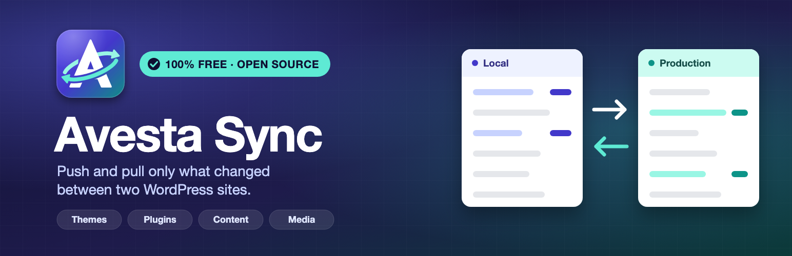

<p align="center">
  
</p>

# Avesta Sync

Free and open source (GPL-2.0-or-later). Two-way sync (push/pull) of theme files, plugin folders, content and media between two WordPress sites. Only items whose SHA-256 differs are transferred, in chunks, over a signed REST API. The user-facing description lives in `readme.txt`; this file is for developers.

## Setup
1. Install and activate the plugin on both sites (a secret key is generated on activation).
2. On the remote site open Tools > Avesta Sync > Settings and copy "This site's secret key".
3. On the site you work from, enter the remote URL (HTTPS required; localhost, `*.localhost`, `*.test` excepted) and paste that key under "Remote secret key".
4. Pick scopes (theme, plugins, content, uploads), the themes and the plugin folders. Save, then "Test connection".

## Sync flow
1. **Compare** reads both sides. It writes nothing except baseline hashes of identical items.
2. With no baseline yet, every differing item is a **conflict** with no default direction. Use the diff preview, then choose per row or in bulk.
3. **Apply selected** runs items one by one with a live log. Deletions are never preselected and ask for confirmation.
4. Later compares use the baseline, so one-sided changes get a default (local change = push, remote change = pull).

## Admin tabs
- **Dashboard**: connection, last sync, last check, backups, schedule.
- **Sync**: compare, filter, diff preview, apply.
- **Backups**: runs and items, one-click restore (a restore is itself backed up), delete run.
- **History**: last 50 runs with per-item results.
- **Settings**: remote, scopes, exclude patterns, scheduled check, backup retention.

## CLI
```
wp avesta-sync status  [--scope=theme,plugins,content,uploads,woocommerce]
wp avesta-sync push    [--scope=...] [--dry-run] [--stock] [--yes]
wp avesta-sync pull    [--scope=...] [--dry-run] [--stock] [--yes]
wp avesta-sync backups
wp avesta-sync restore <run> <path>
```
On Studio: `studio wp avesta-sync ...`. CLI push/pull applies only the default direction; conflicts and deletions are left for the admin UI.

## WooCommerce
Optional section, must be enabled on both sites (same major WooCommerce version). Spec: `SPEC.md`.

- Items: `wc_attr:<slug>`, `wc_term:<taxonomy>:<slug>`, `wc_product:sku:<sku>` or `wc_product:slug:<slug>` (variations embedded), `wc_coupon:<code>`, `wc_set:<group>`.
- All writes go through the WooCommerce CRUD API; references (linked products, terms, images) travel as SKU, slug or file path, never IDs.
- Never written: orders, customers, sessions, reviews, sales counts, coupon usage, gateway settings, API keys, webhooks, email settings.
- Stock state (manage stock, backorders, quantity, status, low-stock amount) is excluded from hashes and written only on create or when the run carries the stock flag (`--stock` on the CLI, the checkbox in the apply dialog).
- Store settings are an allow-list with typed values (`includes/woo/class-woo-settings.php`); shipping methods are limited to flat rate, free shipping and local pickup.
- The receiving site enforces its own section and sub-option switches for import, delete and export.
- Filters: `avesta_sync_wc_product_types`, `avesta_sync_wc_setting_keys` (remove only), `avesta_sync_wc_shipping_methods` (add only).

## Exclude patterns
One glob per line in Settings, matched against the relative path (`themes/my-theme/src/*`). A pattern without `/` matches the file name (`*.map`). They filter the compare list on both sides; they are a convenience, not a security boundary.

## Scheduled check
Optional WP-Cron event (`avesta_sync_scheduled_check`) that runs a read-only compare and emails a summary when differences change. It never applies anything.

## Backups
Anything overwritten or deleted on the receiving side is copied first to `wp-content/uploads/avesta-sync-backups-<token>/<YYYYmmdd-His>/<relative path>.asbak` (content items as JSON under `content/`). The directory has a random name, carries deny files, is excluded from sync, and a legacy `wp-content/avesta-sync-backups-<token>` directory is moved there automatically. Old runs are pruned to the number set in Settings. Add `avesta-sync-backups-*` to your VCS ignore list.

## Security notes
- Every request is signed (HMAC-SHA256 over method, route, timestamp, body hash); 300 s skew limit, replayed signatures rejected, failed attempts throttled.
- **Whoever holds a site's key can write PHP files to that site.** Keep it secret, use HTTPS, regenerate it in Settings if it leaks (then update the other site).
- PHP files that fail to parse are refused. Executable file types are never written into uploads. `wp-config.php`, `.env`, `.git`, `node_modules`, logs, mu-plugins and this plugin are never synced.
- Plugin activation state is never synced.

## Limits
- Media Library entries sync by file path and need the file present first (enable the Media uploads scope).
- `wp_navigation` block references (`ref` IDs) are not remapped between sites.
- Posts with an empty slug are skipped; featured images map by file name only if the attachment already exists.
- Options synced: blogname, blogdescription, show_on_front, page_on_front, page_for_posts (pages mapped by slug).
- Both sites should run the same plugin version; a 1.0.0 peer ignores exclude patterns and media entries.

## Release
WordPress.org listing assets (icon, banner, screenshots) are in `.wordpress-org/` and go to the SVN `assets/` directory, not into the plugin zip.
